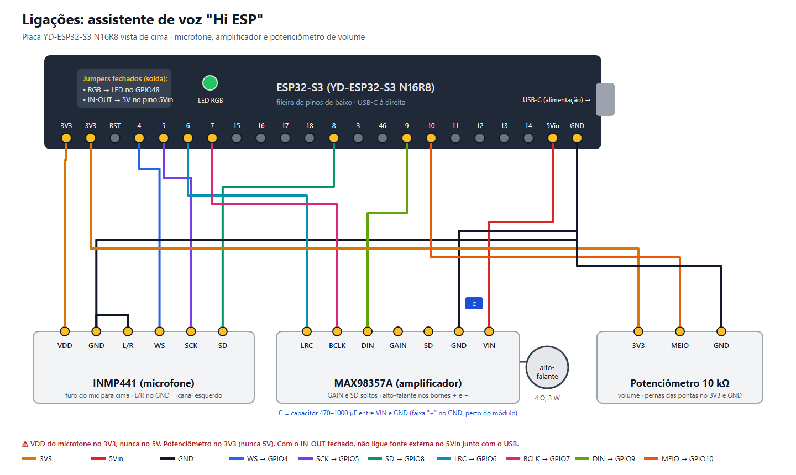

# Firmware da placa (AssistenteVoz)

Firmware Arduino para **ESP32-S3 N16R8** (YD-ESP32-S3) com microfone **INMP441**. A placa:

- fica ouvindo a wake word **"Hi ESP"** localmente (ESP-SR / WakeNet9), sem enviar áudio antes dela;
- mantém uma conexão **WebSocket** sempre aberta com o servidor de voz;
- depois do "Hi ESP", envia o mic ao servidor (PCM 16 kHz). O áudio já é gravado numa fila desde a wake word, então o começo da fala não se perde;
- toca o áudio das respostas no **alto-falante** (MAX98357A: LRC GPIO6, BCLK GPIO7, DIN GPIO9, VIN no 5Vin; ver [docs/amplificador.png](../../docs/amplificador.png)). O volume fica em `VOLUME_ALTO_FALANTE` (0-100, padrão 40) no `config.h`.

O protocolo está em [`../../docs/contrato.md`](../../docs/contrato.md).

## Hardware



Diagrama gerado por [`docs/gerar_ligacoes.py`](../../docs/gerar_ligacoes.py) (linha tracejada = MAX98357A, quando chegar).

| INMP441 | ESP32-S3 |
|---|---|
| VDD | 3V3 (**nunca 5V**) |
| GND | GND |
| L/R | GND (canal esquerdo) |
| WS | GPIO4 |
| SCK | GPIO5 |
| SD | GPIO8 |

**LED RGB (GPIO48)** indica a situação:

| Cor | Situação |
|---|---|
| 🔴 Vermelho | Sem conexão (Wi-Fi ou servidor) |
| 🟢 Verde | Conectado, esperando "Hi ESP" |
| 🔵 Azul | Ouvindo (após o "Hi ESP" e na janela de continuação) |

O LED RGB só funciona com o **jumper "RGB" da placa fechado** com solda. O brilho é ajustado em `LED_BRILHO`, no `.ino`. Os LEDs TX/RX não são mais usados.

**Sinal sonoro de "estou ouvindo":** logo após o "Hi ESP", a placa toca três notas curtas no alto-falante. Na janela de continuação depois de uma resposta, só o LED acende, sem som. O mic descarta ~0,45 s de áudio logo depois, para o próprio bipe não ser enviado ao servidor como fala.

## Configuração

Copie `config.example.h` para **`config.h`** (fica fora do git) e preencha:

| Campo | Desenvolvimento (servidor no notebook) | Produção (VPS) |
|---|---|---|
| `WIFI_SSID` / `WIFI_SENHA` | sua rede **2,4 GHz** | idem |
| `SERVIDOR_HOST` | IP do notebook (ex. `192.168.0.10`) | domínio (ex. `voz.seudominio.com.br`) |
| `SERVIDOR_PORTA` | `8000` | `443` |
| `SERVIDOR_TLS` | `0` | `1` |
| `TOKEN_PLACA` | igual ao `TOKEN_PLACA` do servidor | idem |
| `GANHO_MIC` | `4` | `4` |

O `config.h` é compilado dentro do firmware. Depois de mudar qualquer valor, **compile e grave de novo**: apertar RST não basta.

## Compilar e gravar

**Partição personalizada:** ESP-SR + Wi-Fi + TLS ocupam ~3,2 MB e não cabem no app de 3 MB do esquema "ESP SR 16M". O `partitions.csv` desta pasta usa um app de **6 MB** (sem OTA) e mantém os modelos de voz em `0xC10000`. Ele substitui o esquema escolhido no menu.

### Pelo arduino-cli (recomendado: grava também os modelos de voz)

```bash
FQBN="esp32:esp32:esp32s3:CDCOnBoot=cdc,FlashSize=16M,PSRAM=opi,PartitionScheme=esp_sr_16"
arduino-cli lib install "WebSockets"          # uma vez (Markus Sattler / links2004)
arduino-cli compile --fqbn "$FQBN" --build-property "upload.maximum_size=6291456" .
arduino-cli upload -p COM4 --fqbn "$FQBN" .
```

### Pela Arduino IDE

- Placa: **ESP32S3 Dev Module**
- USB CDC On Boot: **Enabled**
- Flash Size: **16MB**
- PSRAM: **OPI PSRAM**
- Partition Scheme: **Custom** (usa o `partitions.csv`)
- Biblioteca: **WebSockets** (Markus Sattler)

A IDE não grava os modelos de voz. Se eles nunca foram gravados na placa, use o arduino-cli uma vez.

**Antes de gravar, feche o leitor de logs (player) e o Monitor Serial**, porque os dois ocupam a porta. Se o upload não conectar, segure **BOOT**, aperte **RST**, solte **BOOT** e tente de novo.

## Problemas conhecidos

- **Uma única frase de comando trava a MultiNet7 no boot** (StoreProhibited em `build_fsts`). Por isso o `audio.cpp` registra 4 frases, mesmo sem usar o modo de comandos.
- **Wi-Fi não conecta:** o log mostra `Wi-Fi falhou, motivo N` (15/204 = senha errada, 201 = rede não encontrada). O ESP32-S3 só conecta em redes **2,4 GHz**.
- **Em produção, o TLS não verifica o certificado** do servidor (protótipo).

## Logs

Os logs saem pela USB com o prefixo `LOG ` e aparecem no player como `[placa] ...`.
